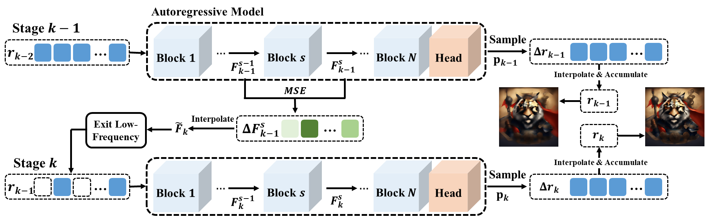

# Frequency-Aware Autoregressive Modeling for Efficient High-Resolution Image Synthesis

> **📌 ICCV 2025 | Official Code Release**  
> This repository hosts the official implementation of our ICCV 2025 paper:  
> **"Frequency-Aware Autoregressive Modeling for Efficient High-Resolution Image Synthesis"**  
> 🔥 Up to **2× speedup** for high-res image synthesis with minimal quality drop.

---

## 🔍 Abstract

Visual autoregressive modeling, based on the next-scale prediction paradigm, generates images by progressively refining resolution across multiple stages. However, the computational overhead in high-resolution stages remains a challenge due to the large number of tokens.  
We introduce **SparseVAR**, a plug-and-play acceleration framework that **dynamically excludes low-frequency tokens during inference** with **no extra training**. On **Infinity-2B**, SparseVAR achieves **up to 2× speedup** with **minimal quality degradation**.

---

## 🖼️ Method

📄 **Method Diagram:**  


---

## 💡 Highlights

- ✅ **No retraining required**  
- ⚡ **Dynamic skipping of low-frequency tokens**  
- 🧩 **Compatible with Infinity and HART**  
- 🚀 **Up to 2× faster** high-resolution inference

---

## 📦 Installation

```bash
git clone https://github.com/Caesarhhh/SparseVAR.git
cd SparseVAR
pip install -r requirements.txt
```

---

## 📂 Main Repository Structure

```
SparseVAR/
├── infinity/                     # Infinity integration
│   ├── scripts/
│   │   ├── eval_sparsevar.sh
│   │   └── eval_baseline.sh
│   ├── weights/                  # place Infinity weights here
│   ├── evaluation/               # evaluation configs & data
│   └── cus_datasets/             
│
├── hart/                         # HART integration
│   ├── scripts/
│   │   ├── eval_sparsevar.sh
│   │   └── eval_baseline.sh
│   ├── weights/                  # place HART weights here
│   ├── evaluation/               # evaluation configs & data
│   └── cus_datasets/             
│
├── requirements.txt
└── assets/
    └── method_exit.png

```

> ⚠️ **Usage**: enter `infinity/` or `hart/` folder and run evaluation scripts.

---

## 🔑 Model Weights Setup

### Infinity
- Download from [Infinity repo](https://github.com/FoundationVision/Infinity):
  - `infinity_2b_reg.pth`
  - `infinity_vae_d32_reg.pth`
- Download Mask2Former:
  - [`mask2former_swin-s-p4-w7-224_lsj_8x2_50e_coco.pth`](https://github.com/FoundationVision/Infinity/issues/34)  
- Place files into:
  - `infinity/weights/infinity_2b_reg.pth`
  - `infinity/weights/infinity_vae_d32_reg.pth`
  - `infinity/weights/mask2former/mask2former_swin-s-p4-w7-224_lsj_8x2_50e_coco.pth`

### HART
- Download [hart-0.7b-1024px](https://huggingface.co/mit-han-lab/hart-0.7b-1024px)  
  → Place into `hart/weights/`
- Download Mask2Former:
  - `mask2former_swin-s-p4-w7-224_lsj_8x2_50e_coco.pth`
  → Place into `hart/weights/mask2former/`

---

## 📊 Prepare Datasets for Evaluation

### GenEval
- Repo: <https://github.com/djghosh13/geneval>  
- Copy `prompts/` and `object_names.txt` into:
  ```
  evaluation/gen_eval/
  ```

### DPG-Bench
- Repo: <https://github.com/TencentQQGYLab/ELLA>  
- Copy `dpg_bench/` into:
  ```
  cus_datasets/dpg_bench/
  ```

---

## ▶️ Running Evaluation

### Infinity
```bash
cd infinity
bash scripts/eval_sparsevar.sh   # SparseVAR acceleration
bash scripts/eval_baseline.sh    # Baseline
```

### HART
```bash
cd hart
bash scripts/eval_sparsevar.sh
bash scripts/eval_baseline.sh
```

---

## 📖 Citation

```bibtex
@inproceedings{chen2025sparsevar,
  title     = {Frequency-Aware Autoregressive Modeling for Efficient High-Resolution Image Synthesis},
  author    = {Chen, Zhuokun and Fan, Jugang and Yu, Zhuowei and Zhuang, Bohan and Tan, Mingkui},
  booktitle = {Proceedings of the IEEE/CVF International Conference on Computer Vision (ICCV)},
  year      = {2025}
}
```

---

## 🙏 Acknowledgements

This repository is built upon and inspired by the excellent works:

- [Infinity](https://github.com/FoundationVision/Infinity)  
- [HART](https://github.com/mit-han-lab/hart)  

We thank the authors and maintainers of these repositories for open-sourcing their code and models, which made this work possible.

---

## 📝 License

This repository is for academic research only. For Infinity and HART code/models, please follow their respective licenses.
